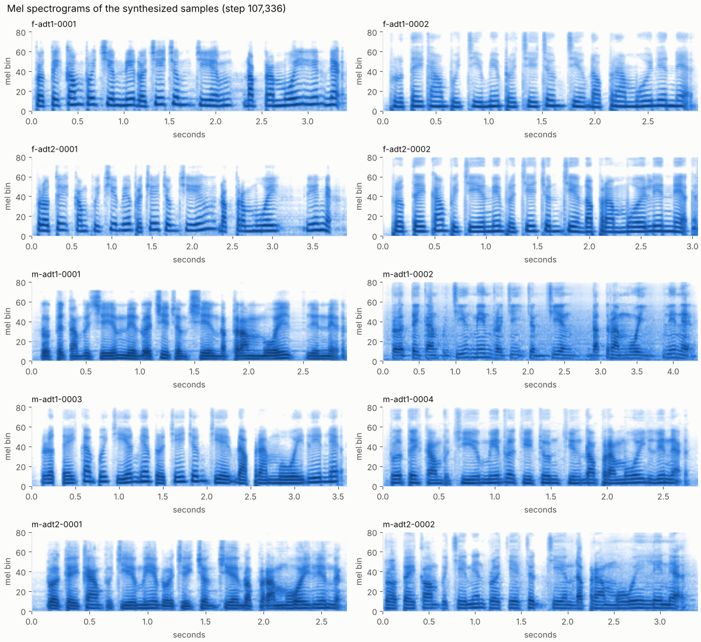
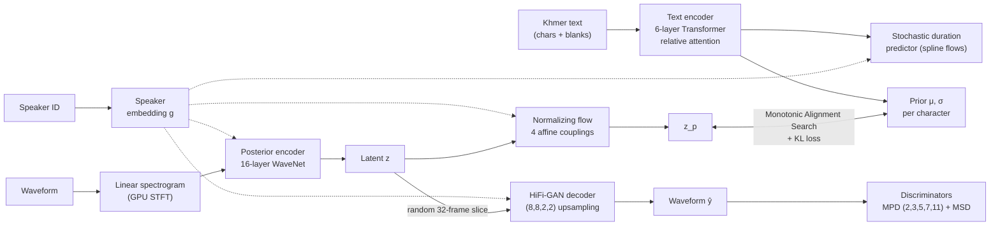
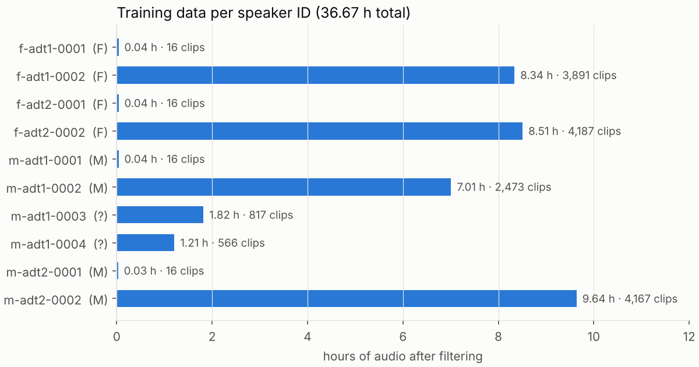
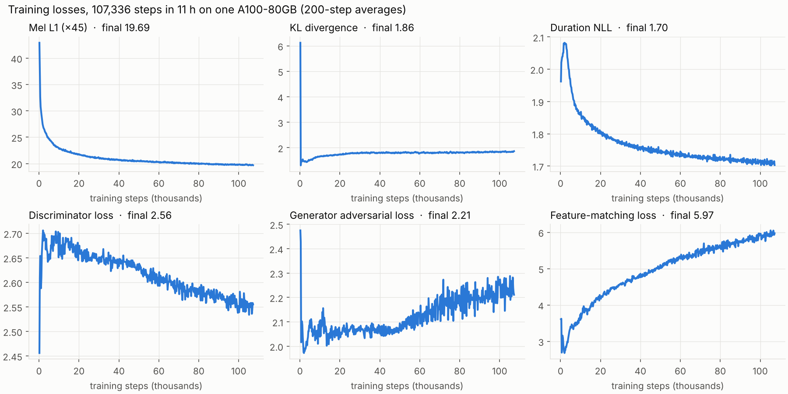

# Khmer VITS TTS

**End-to-end Khmer (ខ្មែរ) text-to-speech trained from scratch** with VITS on the open
*Khmer ASR Cultural Dataset*, in 11 hours on a single A100 GPU.

One multi-speaker model, 10 voices, reads Khmer script directly (no phonemizer or G2P needed),
expands Khmer/Arabic numerals to words, and generates 22.05 kHz audio.


[](https://huggingface.co/Lykheang/khmer_vits_tts_v1)

**🤗 Pretrained model:** https://huggingface.co/Lykheang/khmer_vits_tts_v1

---

## Contents
0. [Quick start: use the pretrained model](#0-quick-start-use-the-pretrained-model)
1. [Samples](#1-samples)
2. [Installation and usage](#2-installation-and-usage)
3. [Model: origin and architecture](#3-model-origin-and-architecture)
4. [Dataset](#4-dataset)
5. [Methodology](#5-methodology)
6. [Experiments and results](#6-experiments-and-results)
7. [Limitations and responsible use](#7-limitations-and-responsible-use)
8. [Project structure](#8-project-structure)
9. [Development](#9-development)
10. [Licence, attribution and citation](#10-licence-attribution-and-citation)

---

## 0. Quick start: use the pretrained model

No training needed: download the trained model from Hugging Face and generate Khmer speech in a
minute. A GPU is optional; it also runs on a normal CPU (including free Google Colab).

### Install
```bash
pip install git+https://github.com/LykheangPeng/Khmer_VITs_TTS.git huggingface_hub
```
In Google Colab, put `!` in front: `!pip install git+https://github.com/LykheangPeng/Khmer_VITs_TTS.git huggingface_hub`.
If `import khmer_vits` then fails, use **Runtime → Restart session** once.

### Generate speech (Python)
```python
from huggingface_hub import hf_hub_download
from khmer_vits.inference import load_generator, synthesize
import soundfile as sf

ckpt = hf_hub_download("Lykheang/khmer_vits_tts_v1", "G_latest.pt")   # ~160 MB, downloaded once
net_g, hp, tok, speakers = load_generator(ckpt)                        # uses the GPU if available
print(speakers)                                                         # the 10 voice IDs

text = "សួស្តី! ខ្ញុំនិយាយភាសាខ្មែរ។"
audio = synthesize(net_g, tok, hp, text, speaker=speakers.index("f-adt2-0002"))
sf.write("hello.wav", audio, hp["sample_rate"])
```
In a notebook, play it directly:
```python
import IPython.display as ipd
ipd.display(ipd.Audio(audio, rate=hp["sample_rate"]))
```

### Every voice at once
```python
for name in speakers:
    audio = synthesize(net_g, tok, hp, text, speaker=speakers.index(name))
    sf.write(f"{name}.wav", audio, hp["sample_rate"])
```

### Generate speech (command line)
```bash
python -c "from huggingface_hub import hf_hub_download; hf_hub_download('Lykheang/khmer_vits_tts_v1', 'G_latest.pt', local_dir='.')"
khmer-vits synth --ckpt G_latest.pt --text "សួស្តី! ខ្ញុំនិយាយភាសាខ្មែរ។" --speaker f-adt2-0002 --out hello.wav
khmer-vits synth --ckpt G_latest.pt --text_file lines.txt --speaker all --out out/tts.wav   # one line per sentence
```

### Choosing a voice and style
- **Recommended voices** (most training data): `f-adt1-0002`, `f-adt2-0002` (female), `m-adt1-0002`, `m-adt2-0002` (male).
- **Speed**: `length_scale=1.2` slower, `0.8` faster.
- **Expressiveness**: `noise_scale` (default 0.667) changes voice/intonation variation, `noise_scale_w` (default 0.8) changes rhythm variation. Lower values sound flatter and more stable.

```python
audio = synthesize(net_g, tok, hp, text, speaker=speakers.index("m-adt2-0002"),
                   noise_scale=0.5, noise_scale_w=0.6, length_scale=1.1)
```

### Tips
- Write numbers as digits or words; both work: `១៦` and `16` are read as `ដប់ប្រាំមួយ`.
- Long paragraphs are fine; they are split at `។ ៕ ? !` automatically.
- English words (Latin letters) are skipped, and decimals, dates and times are not read correctly yet (see [§7](#7-limitations-and-responsible-use)).
- Generated speech is synthetic; please label it as such when sharing.

---

## 1. Samples

All ten clips say the same sentence, generated by the checkpoint at **step 107,336** (end of the
11-hour run) with the default inference settings (`noise_scale=0.667`, `noise_scale_w=0.8`,
`length_scale=1.0`). They are the raw model output, with no post-processing.

> **ប្រទេសកម្ពុជាមានប្រជាជនជាង ១៦ លាននាក់**
> *"Cambodia has a population of more than 16 million people."*
> The text frontend reads the numeral **១៦** as **ដប់ប្រាំមួយ** ("sixteen").

| Speaker ID | Gender¹ | Training data | Sample |
|---|---|---|---|
| f-adt1-0002 | F | 8.34 h · 3,891 clips | [f-adt1-0002.wav](samples/f-adt1-0002.wav) |
| f-adt2-0002 | F | 8.51 h · 4,187 clips | [f-adt2-0002.wav](samples/f-adt2-0002.wav) |
| m-adt1-0002 | M | 7.01 h · 2,473 clips | [m-adt1-0002.wav](samples/m-adt1-0002.wav) |
| m-adt2-0002 | M | 9.64 h · 4,167 clips | [m-adt2-0002.wav](samples/m-adt2-0002.wav) |
| m-adt1-0003 | ? | 1.82 h · 817 clips | [m-adt1-0003.wav](samples/m-adt1-0003.wav) |
| m-adt1-0004 | ? | 1.21 h · 566 clips | [m-adt1-0004.wav](samples/m-adt1-0004.wav) |
| f-adt1-0001 | F | 0.04 h · 16 clips | [f-adt1-0001.wav](samples/f-adt1-0001.wav) |
| f-adt2-0001 | F | 0.04 h · 16 clips | [f-adt2-0001.wav](samples/f-adt2-0001.wav) |
| m-adt1-0001 | M | 0.04 h · 16 clips | [m-adt1-0001.wav](samples/m-adt1-0001.wav) |
| m-adt2-0001 | M | 0.03 h · 16 clips | [m-adt2-0001.wav](samples/m-adt2-0001.wav) |

¹ From the dataset's `speaker_metadata.csv`. "?" means the ID is not listed there.
GitHub does not play `.wav` inline: open a file and click **View raw** / **Download**.

The last four voices were learned from only ~2.5 minutes of audio each. The shared model still
produces them, but they are the least reliable voices (see [§7](#7-limitations-and-responsible-use)).



---

## 2. Installation and usage

### Requirements
- Python ≥ 3.10, PyTorch ≥ 2.1.
- For training: an NVIDIA GPU. bf16 needs Ampere or newer (A100, RTX 30xx/40xx, L4…); older GPUs fall back to fp32 automatically. The reference run used an A100-80GB with batch 32; use `--batch_size 16`–`24` on 16–24 GB cards.
- Disk: about 26 GB for the download and extraction (both can be deleted after `prepare`), plus 6 GB for the prepared data and about 2.5 GB for checkpoints.

### Install (for training)
```bash
git clone https://github.com/LykheangPeng/Khmer_VITs_TTS.git
cd Khmer_VITs_TTS
pip install -e ".[download,logging]"      # installs the package and the `khmer-vits` command
```
Install the PyTorch build that matches your CUDA version first if needed (see pytorch.org).

### 1) Download the dataset
Create an account on [Mozilla Data Collective](https://mozilladatacollective.com/datasets/cmkcy8in2004umo0775mye43g),
**accept the dataset terms** on the dataset page, and create an API key (Profile → API / Credentials).
```bash
export MDC_API_KEY=your-key            # never commit this key
khmer-vits download --out data/raw     # ~12.6 GB archive, resumes if interrupted
```
If you already have the archive, use `khmer-vits download --archive path/to/file.tar.gz --out data/raw`.

### 2) Prepare
```bash
khmer-vits prepare --src data/raw --out data/prep
```
This resamples to 22.05 kHz, trims, normalises, filters and writes `data/prep/audio_int16.bin` + `manifest.json`.
It takes about 1 minute on 12 CPU cores and prints a per-speaker summary.

### 3) Train
```bash
khmer-vits train --data data/prep --run_dir runs/khmer_multispeaker --hours 11 --batch_size 32
tensorboard --logdir runs/khmer_multispeaker/logs      # optional: losses + audio samples
```
- **Resuming**: run the same command again. The newest checkpoint is loaded and `--hours` is a *total* budget across runs, so pass a larger value to train longer.
- **Stopping**: Ctrl-C (or SIGTERM) finishes the current step, saves a checkpoint and exits.
- **Every 30 minutes**: a checkpoint (`ckpt_*.pt`, last 2 kept), `G_latest.pt` for inference, and one listening sample per speaker in `samples/step_*/`, next to `samples/ground_truth/`.
- **One voice only**: `--speakers f-adt2-0002` (use a new `--run_dir`).
- **Other hyper-parameters**: copy `configs/base.json`, edit it, and pass `--config my.json`.

`khmer-vits train --help` lists every option (precision, workers, checkpoint interval, gradient clipping…).

### 4) Synthesize
```bash
khmer-vits synth --ckpt runs/khmer_multispeaker/G_latest.pt \
    --text "ប្រទេសកម្ពុជាមានប្រជាជនជាង ១៦ លាននាក់" --speaker f-adt2-0002 --out out.wav
khmer-vits synth --ckpt runs/khmer_multispeaker/G_latest.pt --text_file lines.txt --speaker all --out out/tts.wav
```
| Option | Default | Effect |
|---|---|---|
| `--speaker` | `0` | index, speaker ID, or `all` |
| `--noise_scale` | 0.667 | timbre and prosody variation |
| `--noise_scale_w` | 0.8 | rhythm (duration) variation |
| `--length_scale` | 1.0 | > 1 slower, < 1 faster |

### Python API
```python
import soundfile as sf
from khmer_vits.inference import load_generator, synthesize

net_g, hp, tokenizer, speakers = load_generator("runs/khmer_multispeaker/G_latest.pt")
audio = synthesize(net_g, tokenizer, hp, "សួស្តី! ខ្ញុំនិយាយភាសាខ្មែរ។", speaker=speakers.index("m-adt2-0002"))
sf.write("hello.wav", audio, hp["sample_rate"])
```
Long texts are split at `។ ៕ ? !` and joined with short pauses. See also [`examples/synthesize.py`](examples/synthesize.py).

### Make targets
`make install`, `make download` (needs `MDC_API_KEY`), `make prepare`, `make train HOURS=11 BATCH=32`,
`make tensorboard`, `make samples`, `make test`.

### Pretrained checkpoint
The weights are **not stored in git**. The trained model from the reference run (`G_latest.pt`, ≈160 MB:
weights, config, vocabulary and speaker list) is on Hugging Face:
**https://huggingface.co/Lykheang/khmer_vits_tts_v1**, released under **CC-BY-SA-4.0**
(see [§10](#10-licence-attribution-and-citation)). See [§0](#0-quick-start-use-the-pretrained-model) for how to use it.

---

## 3. Model: origin and architecture

### Origin
The model is **VITS** (*Variational Inference with adversarial learning for end-to-end
Text-to-Speech*), introduced by Jaehyeon Kim, Jungil Kong and Juhee Son (Kakao Enterprise) in
**"Conditional Variational Autoencoder with Adversarial Learning for End-to-End Text-to-Speech"**,
ICML 2021 ([arXiv:2106.06103](https://arxiv.org/abs/2106.06103)). The official implementation is
[github.com/jaywalnut310/vits](https://github.com/jaywalnut310/vits) (MIT).

This repository is an independent PyTorch port of that implementation, organised as the `khmer_vits` package. It keeps
the original *base* hyper-parameters (the ones used for the paper's VCTK multi-speaker model)
and adds a Khmer text frontend and training infrastructure for a single GPU.
VITS builds on:
- **Glow-TTS**: monotonic alignment search and the flow-based prior ([Kim et al., NeurIPS 2020](https://arxiv.org/abs/2005.11129))
- **HiFi-GAN**: the decoder and the multi-period discriminator ([Kong et al., NeurIPS 2020](https://arxiv.org/abs/2010.05646))
- **MelGAN**: the multi-scale discriminator ([Kumar et al., NeurIPS 2019](https://arxiv.org/abs/1910.06711))
- **Neural Spline Flows**: rational-quadratic splines in the duration predictor ([Durkan et al., NeurIPS 2019](https://arxiv.org/abs/1906.04032))

### Architecture
VITS is a conditional VAE trained end-to-end on (text, waveform) pairs. Unlike two-stage
systems (acoustic model → mel spectrogram → vocoder), it learns the alignment, durations,
acoustics and waveform jointly, and generates audio directly from text.



| Component | Configuration | Role |
|---|---|---|
| Text encoder | embedding 192 → 6 Transformer layers, 2 heads, FFN 768, kernel 3, relative-position window 4, dropout 0.1 | Contextual character representations; projects to prior mean/log-std (192-d) |
| Posterior encoder | 513-bin linear spectrogram → 16 non-causal WaveNet layers (kernel 5, 192 ch) | Encodes ground-truth audio into latent `z` (training only) |
| Normalizing flow | 4 residual coupling layers (WaveNet, 4 layers each) + channel flips | Makes the text prior expressive: `z ↔ z_p` |
| Monotonic alignment search | dynamic programming (numba) | Finds the most likely hard text-to-frame alignment, no external aligner |
| Stochastic duration predictor | DDS-conv + 4 rational-quadratic spline flows, variational dequantization | Samples natural, varied phoneme durations |
| Decoder | HiFi-GAN V1: upsampling ×8×8×2×2 (=256 hop), ResBlock1 kernels 3/7/11, dilations 1/3/5, 512 initial ch | Latent frames → 22.05 kHz waveform |
| Discriminators | multi-period (periods 2,3,5,7,11) + multi-scale | Adversarial training for waveform realism |
| Speaker conditioning | 256-d embedding per speaker ID, fed to all conditional blocks | One model, many voices |
| Size | Generator **39.7 M** params, discriminators **46.7 M** params | Only the generator is needed at inference |

**Training objective** (as in the paper):
`L = L_recon(mel L1 ×45) + L_KL + L_dur + L_adv(G) + L_fm`, with least-squares GAN losses and the
discriminators trained in alternation.

---

## 4. Dataset

| | |
|---|---|
| **Name** | Khmer ASR Cultural Dataset |
| **Steward / creator** | [Digital Divide Data (DDD)](https://www.digitaldividedata.com/) |
| **Source** | [Mozilla Data Collective, dataset `cmkcy8in2004umo0775mye43g`](https://mozilladatacollective.com/datasets/cmkcy8in2004umo0775mye43g), released 2026-01-13. Also mirrored on Hugging Face as `DDD-Cambodia/khm-asr-cultural` |
| **Licence** | [CC-BY-SA-4.0](https://creativecommons.org/licenses/by-sa/4.0/), with attribution to Digital Divide Data required. The terms forbid attempts to identify the speakers |
| **Content** | 37.62 h, 16,339 manually curated speech–text pairs (mean 8.29 s ± 3.87 s) read by native Cambodian speakers about cultural topics: 2 topics (*recipes*, *giving gifts*), 118 subtopics |
| **Format** | `metadata.csv` (Topic, Subtopic, Speaker ID, Paragraph ID, Sentence ID, Sentences), `speaker_metadata.csv`, `data/<topic>/{speaker_id}_khm_{sentence_id}.wav` |
| **Speakers** | The dataset page lists 8 speakers (4 female, 4 male). `metadata.csv` contains **10 speaker IDs**: 6 with 1.2–9.6 h each, plus 4 IDs with 16 clips each (figure below) |

The dataset was released for ASR, and its card also names TTS as an intended use. A larger
**V2** (106.53 h) exists on Mozilla Data Collective. Training on V2 is untested here.



---

## 5. Methodology

### 5.1 Data preparation (`khmer-vits prepare`)
1. **Matching**: metadata rows are joined to audio via the documented file-name pattern, with fallbacks. Result: 16,335 of 16,340 rows matched.
2. **Text normalisation** for Khmer:
   - Unicode NFC; zero-width spaces (U+200B, commonly used as invisible word separators in Khmer) and other invisible characters removed.
   - Khmer digits (០–៩) and Arabic digits expanded to Khmer number words (`២០២៥` → `ពីរពាន់ម្ភៃប្រាំ`), including thousands separators, `%`, `$` and `៛`. 1,498 utterances contained numbers.
   - Quotes and brackets removed, punctuation unified; Khmer punctuation (`។ ៖ ៗ`) kept as tokens.
3. **Filtering** (counts from the reference run):

   | Rule | Removed |
   |---|---|
   | Ambiguous numbers (decimals, times, dates) | 6 |
   | Latin letters (likely English words) | 36 |
   | Longer than 20 s | 98 |
   | Speaking-rate outliers, robust z > 4 per speaker (likely transcript mismatch) | 30 |

4. **Audio**: mono, resampled to **22,050 Hz** (soxr HQ), DC removed, leading/trailing silence trimmed (40 dB below the loudest frame, 0.1 s margin), loudness normalised to −20 dBFS RMS with a 0.95 peak limit, stored as one int16 memory-mapped file.
5. **Vocabulary**: built from the data, **81 symbols** (Khmer consonants, vowels, diacritics, coeng `្`, punctuation, space) plus the blank token. Characters seen fewer than 3 times are excluded.
6. **Split**: 2 utterances per speaker held out for listening samples (20); **16,145 for training (36.6 h)**.

### 5.2 Training recipe
| Setting | Value |
|---|---|
| Input | characters with interspersed blanks (`add_blank=True`) |
| Audio features | STFT 1024 / hop 256 / window 1024; 80-bin mel for the loss |
| Decoder training window | random 8,192-sample (32-frame) segments |
| Optimiser | AdamW, lr 2×10⁻⁴, β = (0.8, 0.99), ε = 10⁻⁹, weight decay 0.01, ExponentialLR γ = 0.999875 per epoch |
| Loss weights | mel × 45, KL × 1 |
| Batch | 32, length-bucketed ("sortish"), padded to multiples of 32 frames |
| Gradient clipping | global norm 1,000 (G and D); non-finite steps skipped |
| Precision | bf16 autocast for decoder + discriminators; fp32/TF32 for encoders, flow, alignment, duration predictor and KL |
| Budget | 11 h wall clock, checkpoints every 30 min |

### 5.3 Engineering for a single GPU
- Spectrograms computed **on the GPU** per batch; audio travels as int16.
- The whole corpus lives in one **memory-mapped file**, so data loading never stalls the GPU.
- **Real and generated audio** go through each discriminator in one batched pass.
- **No discriminator weight-gradients** during the generator update.
- **Fused AdamW**, cuDNN autotuning on a small set of padded shapes, numba-parallel alignment search.
- **Background checkpointing** with atomic renames. Old checkpoints are truncated before deletion, which keeps synced storage such as a mounted Google Drive from filling its trash.
- **Cumulative time budget** (`--hours`) and automatic resume: re-running the same command continues from the newest checkpoint; Ctrl-C saves before exiting.

---

## 6. Experiments and results

### 6.1 Setup
| | |
|---|---|
| Hardware | 1 × NVIDIA A100-SXM4-80GB (cloud VM, Google Colab Pro) |
| Software | PyTorch 2.14.1 + CUDA 13.0, Python 3.13 |
| Training data | 16,145 utterances, 36.6 h, 10 speaker IDs |
| Duration | 11 h 00 min wall clock (including evaluation and checkpointing) |

### 6.2 Throughput and stability
| Metric | Value |
|---|---|
| Steps completed | **107,336** (212 epochs, 504 steps/epoch) |
| Throughput | **2.74 it/s** median (≈ 88 utterances/s) |
| Skipped steps (non-finite loss) | 0 |
| Out-of-memory events | 0 |
| Learning rate at end | 1.95 × 10⁻⁴ |

### 6.3 Loss curves


| Step | Mel L1 (×45) | KL | Duration NLL | D loss | G adversarial | Feature matching |
|---:|---:|---:|---:|---:|---:|---:|
| 1,000 | 30.04 | 1.46 | 2.04 | 2.59 | 2.10 | 3.16 |
| 10,000 | 22.84 | 1.66 | 1.86 | 2.68 | 2.04 | 3.60 |
| 25,000 | 21.31 | 1.77 | 1.79 | 2.65 | 2.07 | 4.46 |
| 50,000 | 20.45 | 1.79 | 1.75 | 2.63 | 2.09 | 5.10 |
| 75,000 | 20.09 | 1.82 | 1.72 | 2.59 | 2.18 | 5.54 |
| 100,000 | 19.80 | 1.84 | 1.72 | 2.55 | 2.25 | 5.93 |

The full log, one row per 200 steps, is in [`results/train_log.csv`](results/train_log.csv).
`python scripts/make_figures.py` regenerates the figures.

### 6.4 Observations
- **Reconstruction keeps improving.** Mel loss drops fast in the first 10k steps (42.9 → 22.8), then slowly: −0.65 between 50k and 100k steps. The model had not converged when the 11 h budget ended, so longer training should help. The official VITS models were trained for 800k steps.
- **The alignment and duration parts settle early.** KL stabilises around 1.8 after ≈20k steps; duration NLL keeps decreasing slowly (1.70 at the end).
- **The GAN stayed balanced.** Discriminator loss drifts down slowly and generator adversarial and feature-matching losses rise. That is the usual VITS pattern as the discriminator sharpens, with no collapse or divergence and no skipped updates.
- **Low-resource voices.** The four speaker IDs with only 16 clips still produce speech through the shared model. Their spectrograms show less high-frequency energy than the voices with 7–10 h of data.

### 6.5 Evaluation status
No formal evaluation has been run yet: no MOS listening test and no ASR-based intelligibility
score (CER). The samples in [§1](#1-samples) are the only quality evidence provided. Natural next
steps:
- CER of the synthesized speech with an open Khmer ASR model, on held-out sentences.
- A small MOS / preference test with native speakers.
- Continued training: the budget is cumulative, so re-run `khmer-vits train` with a larger `--hours`.

---

## 7. Limitations and responsible use

- **Domain**: the training text covers recipes and gift-giving. Expect more mistakes on other domains, rare words and names.
- **Character-based input**: pronunciation is learned from spelling, so irregular spellings, loanwords and abbreviations can be misread. `ៗ` (repetition mark) is learned implicitly.
- **Not handled by the frontend**: Latin script (skipped), decimals, dates and times (digits are read with the separators left in place).
- **Low-data voices** (16 clips each) are less stable than the six main voices.
- **Voices belong to real people.** Do not use the model to impersonate them or present synthetic speech as genuine, and respect the dataset terms (no attempts to identify speakers). Label generated audio as synthetic where it could be mistaken for a real recording.

---

## 8. Project structure

```
Khmer_VITs_TTS/
├── khmer_vits/                    # the Python package
│   ├── cli.py                     # `khmer-vits download | prepare | train | synth`
│   ├── config.py                  # VITS base hyper-parameters, JSON overrides
│   ├── text/
│   │   ├── normalize.py           # Khmer cleanup, numbers -> words
│   │   └── tokenizer.py           # characters + interspersed blanks
│   ├── data/
│   │   ├── download.py            # Mozilla Data Collective download + extraction
│   │   ├── prepare.py             # matching, filtering, resampling -> int16 memmap + manifest
│   │   └── dataset.py             # memmap dataset, padding collate, length-bucketed sampler
│   ├── audio.py                   # GPU STFT / mel (Slaney filterbank)
│   ├── monotonic_align.py         # MAS (numba, numpy fallback)
│   ├── models/
│   │   ├── commons.py             # masks, slicing, alignment paths, weight-norm compat
│   │   ├── attentions.py          # relative-position Transformer encoder
│   │   ├── modules.py             # WaveNet, DDS-conv, ResBlock, flow layers
│   │   ├── transforms.py          # rational-quadratic spline
│   │   ├── synthesizer.py         # SynthesizerTrn (the VITS generator)
│   │   └── discriminators.py      # MPD + MSD
│   ├── losses.py
│   ├── checkpoint.py              # background, atomic, trash-safe checkpointing
│   ├── train.py                   # training loop
│   └── inference.py               # load_generator(), synthesize()
├── configs/base.json              # = built-in defaults (VITS base)
├── examples/synthesize.py
├── scripts/make_figures.py        # README figures from results/train_log.csv
├── samples/                       # 10 example outputs (step 107,336)
├── results/train_log.csv          # losses every 200 steps from the reference run
├── docs/figures/
├── tests/                         # pytest: unit tests + end-to-end pipeline on fake data
├── Makefile
├── pyproject.toml
├── requirements.txt
├── CITATION.cff
└── LICENSE
```

---

## 9. Development

```bash
pip install -e ".[dev]"
pytest -q                 # 30 tests, ~40 s on CPU, including an end-to-end pipeline run
pytest -q -m "not slow"   # unit tests only
```
The unit tests check the Khmer text frontend and number expansion, that the mel filterbank
matches librosa, that the numba and numpy alignment searches agree and give valid monotonic
paths, the relative-attention index helpers against a naive reference, exact invertibility of the
coupling and spline flows, VITS-base parameter counts, forward and backward passes in fp32 and bf16,
and that weight-norm folding leaves inference output unchanged. The end-to-end test builds a fake
dataset with the real layout (including bad rows the filters must catch), then runs `prepare`,
`train`, a resume, and `synth` through the CLI. CI runs everything on Python 3.10 and 3.12.

---

## 10. Licence, attribution and citation

- **Code**: MIT ([LICENSE](LICENSE)). The code in `khmer_vits/models/` is ported from the official VITS implementation (MIT, © 2021 Jaehyeon Kim); the spline transform follows *nflows* (MIT).
- **Dataset**: Khmer ASR Cultural Dataset by **Digital Divide Data**, CC-BY-SA-4.0. It is not redistributed here; download it from Mozilla Data Collective.
- **Trained weights and audio samples** (`samples/`, [the Hugging Face model](https://huggingface.co/Lykheang/khmer_vits_tts_v1)): derived from the dataset and shared under **CC-BY-SA-4.0** with attribution to Digital Divide Data.

If you use this work, please cite VITS and credit the dataset:

```bibtex
@inproceedings{kim2021vits,
  title     = {Conditional Variational Autoencoder with Adversarial Learning for End-to-End Text-to-Speech},
  author    = {Kim, Jaehyeon and Kong, Jungil and Son, Juhee},
  booktitle = {Proceedings of the 38th International Conference on Machine Learning (ICML)},
  year      = {2021}
}

@misc{ddd2026khmerasrcultural,
  title        = {Khmer ASR Cultural Dataset},
  author       = {{Digital Divide Data}},
  year         = {2026},
  howpublished = {Mozilla Data Collective, \url{https://mozilladatacollective.com/datasets/cmkcy8in2004umo0775mye43g}},
  note         = {CC-BY-SA-4.0}
}
```

See also [CITATION.cff](CITATION.cff).

### Acknowledgements
Digital Divide Data for creating and openly licensing the Khmer speech corpus. Mozilla Data
Collective for hosting it. Jaehyeon Kim, Jungil Kong and Juhee Son for VITS and its open-source
implementation.
